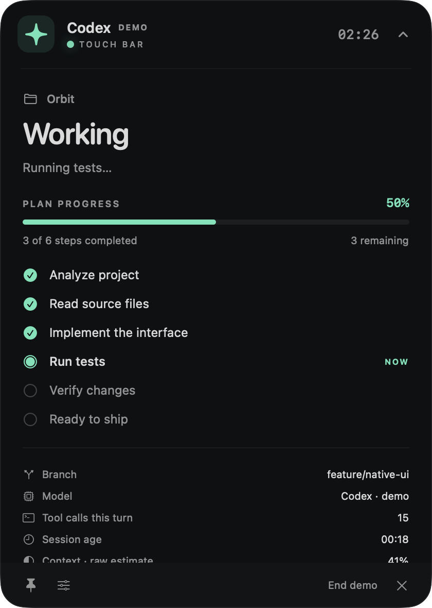
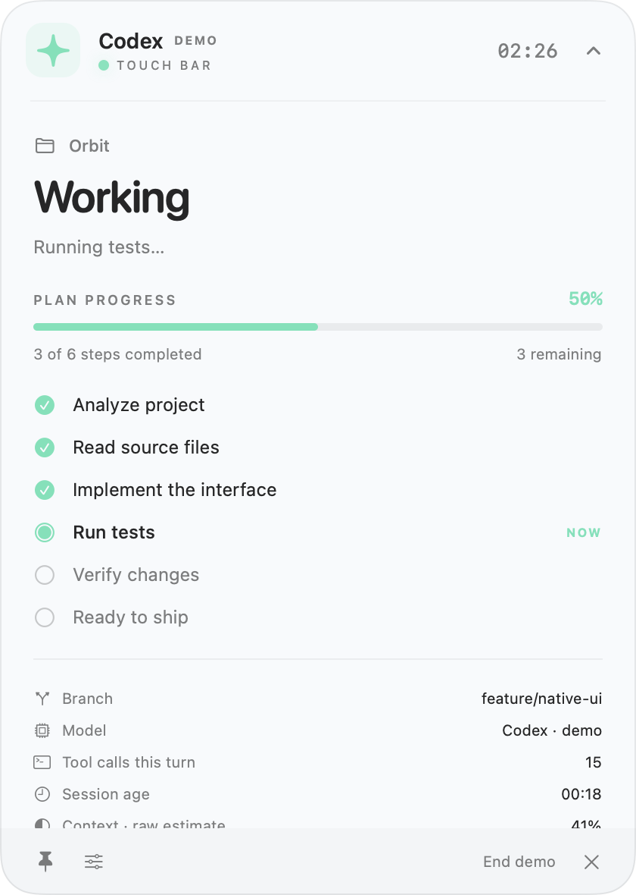

# Codex Touch Bar

A native macOS companion for OpenAI Codex. Follow real local sessions from your menu bar, a small floating island, or your Mac's Touch Bar.

Built with **Swift, SwiftUI and AppKit**, for **macOS 13+**. No Electron, cloud service, analytics, screen scraping or OCR. An independent community project, inspired by [Claude-TouchBar](https://github.com/dawiddrzewiecki/Claude-TouchBar); not affiliated with OpenAI.

<p align="center">
  
  
</p>

These are native rendered screenshots of **Demo Mode**, with simulated data clearly labeled in the app. The progress shown is 3 of 6 completed plan steps.

## Features

- Automatic discovery of up to 30 recently modified local Codex sessions, with independent turn state and timers.
- Working, waiting, completed, error and idle states, plus an honest **Activity unconfirmed** state when telemetry goes quiet.
- Real structured plans: completed steps, remaining steps and a percentage derived only from completed entries. No plan means an activity indicator.
- Floating Bar: click its header to expand/collapse, **drag the sparkle** to move, pin above windows, automatic show/hide, and saved position.
- Menu Bar: current session, session switching, Floating Bar, Touch Bar, settings, launch at login, demo and quit.
- Public `NSTouchBar` support while an app window is active. Floating Bar works on every supported Mac.
- Optional completion, attention and error notifications, with historical replay suppressed.
- Optional approval review through documented Codex hooks: full tool input, **Approve once**, **Deny**, or **Continue in Codex**. A Touch Bar review button opens the same review dialog.
- Model, observed tools/commands, session age, optional context/usage snapshots and read-only Git worktree statistics.
- Dark, light and system appearance; reduced-motion preference respected.
- Demo sequence: analyze → read → write → test → approval → finish → complete.

## Requirements

- macOS 13 or later, Intel or Apple silicon.
- Building: Swift 5.8+ and Apple's Command Line Tools or Xcode. No package dependencies.
- Live monitoring: a local Codex CLI, IDE or desktop client that persists JSONL rollouts under its Codex data folder. Demo requires no Codex installation.
- Optional hook installer: Python 3 (available with the Command Line Tools), and a Codex version that supports the documented lifecycle hooks and `/hooks` trust review.

The implementation was verified on **macOS 13.7.8 / Intel / Swift 5.8.1**, with local **Codex CLI 0.155.0-alpha.16.3** rollouts. The internal rollout format is version-sensitive; see [integration notes](docs/INTEGRATION.md).

## Build and run

```sh
./scripts/build-app.sh
open "build/Codex Touch Bar.app"
```

The result is `build/Codex Touch Bar.app`, including the menu app and optional helper. The binary targets the build machine’s architecture; this workspace’s included bundle/ZIP is Intel x86_64. Build the same sources on Apple silicon for an arm64 binary. The script signs the bundle ad hoc for local use. To build with a Developer ID, set `CODEX_TOUCH_BAR_SIGN_IDENTITY` to that identity; public distribution also requires your own notarization workflow.

On a complete Xcode toolchain you can also use:

```sh
swift build
swift run CodexTouchBar
swift test
```

Use the `.app` bundle for notifications, login registration and the hook installer. `swift run` is convenient for development. This machine's older Command Line Tools have a SwiftPM `PlatformPath` failure and no XCTest framework; `build-app.sh` automatically uses a **direct `swiftc` build of the same sources**. It does not modify Xcode or system toolchain settings. Force that path with `CODEX_TOUCH_BAR_DIRECT_BUILD=1`.

Install in Applications:

```sh
./scripts/install-app.sh
open "/Applications/Codex Touch Bar.app"
```

A custom installation folder is supported, for example `./scripts/install-app.sh "$HOME/Applications"`. The installer refuses to overwrite an existing app; quit and move the old copy aside first.

## Connect to Codex

1. Launch the app and start a normal task in your existing Codex client.
2. The monitor reads `$CODEX_HOME/sessions/**/*.jsonl`, defaulting to `~/.codex/sessions`. It never launches a task, reads `auth.json`, or changes your sandbox/approval policy.
3. If your client uses another data folder, choose **Settings → Connection → Codex data folder → Apply**. Finder-launched apps may not inherit your shell's `CODEX_HOME`, so set the folder explicitly when necessary.
4. Choose a project in **Menu Bar → Sessions**. A newly waiting session receives priority; otherwise a manual selection stays selected. Subagents are hidden by default.

Basic monitoring works without hooks. For approval-request alerts, use **Settings → Install hooks**, or run:

```sh
./scripts/install-hooks.sh --app "$PWD/build/Codex Touch Bar.app"
# For an installed copy:
./scripts/install-hooks.sh --app "/Applications/Codex Touch Bar.app"
```

The installer merges only its own handlers into the selected `hooks.json`, backs up the existing file, and copies the helper to `~/Library/Application Support/Codex Touch Bar/`. It preserves unrelated hooks. For a custom Codex home pass `--codex-home /path/to/codex-data`.

**Restart Codex, run `/hooks`, and review/trust the observer hooks.** The app does not bypass Codex's trust review. Older Codex versions may not support these hooks; basic monitoring remains usable.

Observer hooks record only lifecycle metadata, tool name and identifiers; prompts, tool input and output are dropped. In default observer mode the helper returns `{}` and makes no decisions. `PermissionRequest` may also precede automatic review, so the app says **Approval requested in Codex**; it cannot prove a human prompt remains open. Respond in the original Codex client, or enable the optional review mode below.

### Optional approval buttons

Enable **Settings → Review and answer approvals in this app**, then click **Install hooks** again and review/trust the changed hook definition in Codex with `/hooks`. For a terminal installation, also pass `--approval-ui` to `install-hooks.sh`; the app setting must be enabled too.

When an approval is pending, **Review approval…** appears in Floating Bar and the Touch Bar. Review shows the full proposed tool input and project. Choose **Approve once**, **Deny**, or **Continue in Codex**. The default/Return button is Continue in Codex, never Approve. There is no automatic or session-wide approval.

This opt-in mode uses the documented `PermissionRequest` hook response, bound to a random request ID and expiry. It briefly stores full tool input in private local files so you can inspect the action; this differs from the minimal observer telemetry. Data is removed on resolution/timeout; abandoned expired files are cleaned when the app next scans. If the app is closed, disabled, disconnected or does not receive a decision within two minutes, the helper returns no decision and Codex's usual approval path continues. Existing policy and other hooks still apply. This feature does not answer arbitrary chat questions.

Remove only the observer configuration:

```sh
./scripts/uninstall-hooks.sh
```

This keeps backups and historical local telemetry. You can remove `~/Library/Application Support/Codex Touch Bar` after uninstalling the hooks and quitting the app.

## Which data is real?

| Display | Direct source | Computed by the app |
|---|---|---|
| Session/project/model | `session_meta`, `turn_context` | Project display name from working directory |
| Task start/end/error | Persisted lifecycle markers, when present | Status and elapsed time between timestamps |
| Tool/command | Persisted function/custom calls and outputs | Bounded recent list and recorded call count |
| Plan | Structured `update_plan` arguments | Completed / total entries; no fabricated stages |
| Approval requested | Optional `PermissionRequest` hook | Waiting indicator until observed continuation |
| Question requested | Explicit recorded `request_user_input` call | Pending state until matching output |
| Context | Last token usage and reported context capacity | Raw ratio; not cumulative usage or an exact clone of Codex's display |
| Usage limits | Explicit `token_count.rate_limits`, if supplied | Formatting only; never inferred from subscription or clock |
| Files changed in Codex | Successful persisted patch events, if available | Unique observed paths |
| Branch/files/+− | Read-only local Git snapshot | Whole-worktree counts, **not changes attributed to Codex** |
| Last activity unconfirmed | No recent telemetry for 120 seconds | Freshness warning; never successful completion or guessed approval |

Elapsed time includes time spent waiting. Completion does not mark unfinished plan entries complete. Git line counts cover tracked text relative to HEAD; untracked entries are counted separately, and binary line counts are unavailable. The Git snapshot may include your edits and other tools' work.

## Limitations

- Codex JSONL is an internal fallback, not a stable public telemetry API. Unknown records are ignored. Malformed or oversized lines are skipped; large histories load incrementally. Only the 30 most recently modified rollout files are watched. Archived and remote-only sessions are not included.
- Some formats use paginated history. Basic persisted lifecycle/metadata/raw calls work where present; prose plan items are not converted into stages, and unavailable paginated details stay absent.
- Transient errors, approvals and some tool events are not persisted. Nested tools inside a code-mode wrapper may appear as one recorded wrapper call. A missing error does not prove success.
- Hooks are best-effort observer events, may be missing on unsupported paths, and must be trusted. A `Stop` hook is a stop attempt: another hook can continue the turn, so only a terminal rollout marker establishes success.
- Silence can mean a long command, buffered output, sleeping Mac, lost telemetry or a closed client. After 120 seconds the display becomes **Activity unconfirmed**. A timer measures time since a known start, not proof of continuous execution.
- App-server offers richer live events and safe approval responses **to the client owning that connection**. Starting another server does not attach to an arbitrary existing CLI session. Basic monitoring stays passive. Optional response buttons use the documented PermissionRequest hook described above, not a fabricated app-server attachment.
- Public Touch Bar APIs are app/window-scoped. Choose **Show Touch Bar** to activate the status window. A global Control Strip takeover would require private Apple APIs, which this app does not use. Hardware display was not verified on a physical Touch Bar during this build.
- Enable notifications in Settings. macOS permission, Focus and system preferences control presentation. Login registration is provided via `SMAppService`; install the bundle in Applications before enabling it.
- No universal task-completion percentage, exact remaining time, guaranteed human-waiting flag, global cross-client approval bus or complete account usage feed is assumed.

## Architecture

```text
Sources/
├── CodexTouchBarCore/
│   ├── Models/AgentSession.swift
│   └── Services/
│       ├── AgentProvider.swift
│       ├── CodexProvider.swift
│       ├── RolloutReducer.swift
│       ├── ApprovalStore.swift
│       ├── HookTelemetry.swift
│       └── GitMonitor.swift
├── CodexTouchBar/
│   ├── App/AppDelegate.swift
│   ├── Services/           # SessionManager, notifications, preferences
│   ├── Views/              # Floating Bar, Touch Bar, Settings
│   └── Resources/          # Bundle metadata and native icon
└── CodexTouchBarHook/      # Small synchronous observer executable
Tests/                      # Portable behavioral suite + XCTest model tests
scripts/                    # Build, test, install, hooks and native smoke checks
```

A serial background provider incrementally tails complete lines and reduces them into independent sessions. Main-thread published state drives all views. Git runs separately with external diff/text conversion, executable clean/process filters and filesystem monitors disabled. `AgentProvider` is the extension point for future agents. No other agent providers are implemented.

Read [ARCHITECTURE.md](ARCHITECTURE.md) for the research decisions and [docs/INTEGRATION.md](docs/INTEGRATION.md) for pinned Codex sources.

## Tests and native verification

```sh
./scripts/test.sh
./scripts/build-app.sh
./scripts/smoke-test.sh
```

The portable suite checks real fixture schemas, truthful progress, repeated turns, pending questions, terminal errors, partial/rotated/truncated logs, session isolation, hook merging/privacy, approval timeout/heartbeat and Git statistics. It runs directly with Command Line Tools; `test.sh` also runs XCTest when available. The smoke script requires a logged-in graphical macOS session, creates native windows/menu/Touch Bar items, renders dark/light demo screenshots, reads local sessions, and tests hook installation **only in temporary directories**. It never starts a paid Codex task or installs hooks in your real configuration.

[Verification report](docs/VERIFICATION.md) records the results and manual hardware checks still required.

## Troubleshooting

| Symptom | Action |
|---|---|
| Nothing in the Dock | Expected: this is a menu bar app. Look for the sparkle near the clock. |
| No sessions | Start a local Codex task, then verify Settings → Codex data folder. The app does not read cloud-only history. |
| Activity unconfirmed | Open Codex to inspect its state. Long operations may not emit new telemetry. |
| No percentage | Codex has not emitted a structured `update_plan` call. Activity is shown instead. |
| No approval alert | Verify current Codex hook support, install the observer, restart Codex and trust it with `/hooks`. Watch for the first hook event. |
| No notification banner | Enable notifications in the app and macOS System Settings; check Focus. Run the `.app` bundle. |
| Touch Bar changes when switching apps | Public AppKit behavior. Use Floating Bar for cross-app monitoring. |
| SwiftPM `PlatformPath` / XCTest error | Use `./scripts/build-app.sh` and `./scripts/test.sh`, or select a complete Xcode installation. |
| Hook installer cannot find Python | Install Apple's Command Line Tools; Python is only needed for the optional installer, not monitoring. |
| Gatekeeper / public distribution | Build locally or sign and notarize with your Developer ID. Local ad-hoc signing is not notarization. |

## Acknowledgments

Architecture and visual inspiration: [dawiddrzewiecki/Claude-TouchBar](https://github.com/dawiddrzewiecki/Claude-TouchBar). Implementation here is independent. Codex protocol research uses the official [openai/codex](https://github.com/openai/codex) source and [OpenAI documentation](https://learn.chatgpt.com/docs/app-server).
